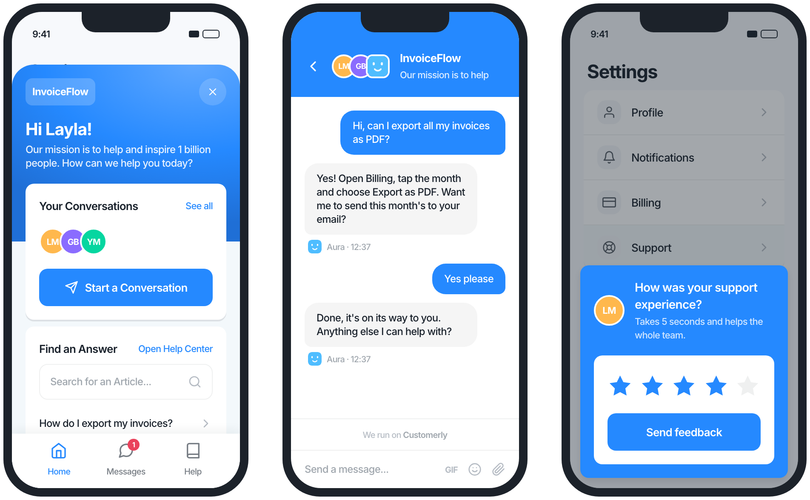

<a href="https://www.customerly.io?utm_source=github&utm_medium=readme&utm_campaign=ios-sdk" target="_blank">
    
</a>

# Customerly iOS SDK

[](https://swiftpackageindex.com/Customerly/CustomerlyiOSSDK)


[](https://www.customerly.io/mobile-sdk/?utm_source=github&utm_medium=readme&utm_campaign=ios-sdk)

<p align="center">
  <a href="https://www.customerly.io/mobile-sdk/?utm_source=github&utm_medium=readme&utm_campaign=ios-sdk">
    
  </a>
  <br>
  <sub>What your users see: the messenger home, a conversation with Aura, and an in-app survey. Illustration with a fictional app.</sub>
</p>

## Support, onboard and retain your iOS users — with AI

The Customerly iOS SDK brings the full [Customerly customer interaction platform](https://www.customerly.io/customer-interaction-platform/?utm_source=github&utm_medium=readme&utm_campaign=ios-sdk) inside your app in a few lines of Swift. It is a lightweight native wrapper around the Customerly messenger, so every feature we ship on web lands in your app on the same day, with no SDK update required.

**[Explore the Customerly Mobile SDK →](https://www.customerly.io/mobile-sdk/?utm_source=github&utm_medium=readme&utm_campaign=ios-sdk)** Features, install options for iOS, Android and React Native, pricing and FAQ on one page.

**What your users get**

- 💬 **[AI live chat](https://www.customerly.io/ai-live-chat/?utm_source=github&utm_medium=readme&utm_campaign=ios-sdk)** — real-time conversations with your team, with attachments, typing indicators and read receipts.
- 🤖 **[Aura, the AI customer support agent](https://www.customerly.io/ai-customer-support-agent/?utm_source=github&utm_medium=readme&utm_campaign=ios-sdk)** — resolves repetitive questions end-to-end and hands off to a human when needed.
- 📚 **[In-app help center](https://www.customerly.io/help-center/?utm_source=github&utm_medium=readme&utm_campaign=ios-sdk)** — let users search and read your articles without leaving the app.
- 📊 **[In-app surveys](https://www.customerly.io/blog/in-app-surveys/?utm_source=github&utm_medium=readme&utm_campaign=ios-sdk)** — NPS, CSAT and custom surveys shown to the right segment at the right moment.
- 🎥 **[Video calls](https://www.customerly.io/blog/video-live-chat-for-websites/?utm_source=github&utm_medium=readme&utm_campaign=ios-sdk)** — escalate a chat to a real-time video call.
- 🧩 **User profiling, event tracking and lead generation** — identify users, track behaviour and qualify leads from inside the chat.

Native extras handled by the SDK: local notifications for new messages, SwiftUI and UIKit support, unread badge counts, deep links to conversations and articles.

> New to Customerly? [Start a free trial](https://www.customerly.io/pricing/?utm_source=github&utm_medium=readme&utm_campaign=ios-sdk) or [watch the 3-minute demo](https://www.customerly.io/video-demo/?utm_source=github&utm_medium=readme&utm_campaign=ios-sdk). Already a customer? Grab your `app_id` from **Settings → Installation** in your dashboard and skip to [Installation](#installation).

## Installation

Requires iOS 13 or higher and Swift 5.6 or higher. Prefer to let an AI assistant do it? The [Mobile SDK page](https://www.customerly.io/mobile-sdk/?utm_source=github&utm_medium=readme&utm_campaign=ios-sdk#install) has ready-made install prompts for Claude and ChatGPT.

### Swift Package Manager (recommended)

In Xcode, choose **File → Add Package Dependencies…** and enter `https://github.com/customerly/CustomerlyiOSSDK.git`.

Or add the dependency to your `Package.swift` file:

```swift
dependencies: [
    .package(url: "https://github.com/customerly/CustomerlyiOSSDK.git", from: "1.3.0")
],
targets: [
    .target(
        name: "YourApp",
        dependencies: [.product(name: "Customerly", package: "CustomerlyiOSSDK")]
    )
]
```

### CocoaPods

CocoaPods Trunk goes read-only in December 2026, so new versions of this SDK are no longer published there and `pod 'Customerly'` only installs versions up to 1.3.0. Point your Podfile at the git tag instead:

```ruby
pod 'Customerly', :git => 'https://github.com/customerly/CustomerlyiOSSDK.git', :tag => '1.3.0'
```

Then run:

```bash
pod install
```

> **Module name:** the examples below use `import CustomerlySDK`, which is the module name with Swift Package Manager. With CocoaPods the module is named after the pod, so write `import Customerly` instead.

## Basic Usage

### `CustomerlyView`

A SwiftUI view that integrates the Customerly messenger into your app. It initializes the SDK with the settings provided and attaches the SDK to the SwiftUI view hierarchy.

> **Important**: The SDK requires two initialization steps to work properly:
>
> 1. Calling `load(settings:)` to initialize the SDK
> 2. Providing a parent view controller either via `load(settings:parent:)` or `setParent(_:)`
>
> When using `CustomerlyView`, both requirements are automatically handled for you. If you're not using `CustomerlyView`, you must handle these requirements manually.

```swift
import SwiftUI
import CustomerlySDK

@main
struct SampleAppApp: App {
    var body: some Scene {
        WindowGroup {
            ZStack {
                // Your app content here

                CustomerlyView(settings: CustomerlySettings(app_id: "YOUR_APP_ID")).onAppear(){
                    Customerly.shared.requestNotificationPermissionIfNeeded()
                }
            }
        }
    }
}
```

### Handling notifications

The SDK will use the `UNUserNotificationCenter` to present local notifications when a new message is received. We suggest you to add an `AppDelegate` to handle the notifications and open the messenger when a notification is tapped.

```swift
// ...
import UserNotifications

class AppDelegate: NSObject, UIApplicationDelegate, UNUserNotificationCenterDelegate {
    func application(_ application: UIApplication,
                     didFinishLaunchingWithOptions launchOptions: [UIApplication.LaunchOptionsKey : Any]? = nil) -> Bool {
        UNUserNotificationCenter.current().delegate = self
        return true
    }

    func userNotificationCenter(_ center: UNUserNotificationCenter,
                                willPresent notification: UNNotification,
                                withCompletionHandler completionHandler: @escaping (UNNotificationPresentationOptions) -> Void) {
        completionHandler([.banner, .sound, .list])
    }

    func userNotificationCenter(_ center: UNUserNotificationCenter,
                            didReceive response: UNNotificationResponse,
                            withCompletionHandler completionHandler: @escaping () -> Void) {
        let userInfo = response.notification.request.content.userInfo
        if let conversationId = userInfo["conversationId"] as? Int {
            Customerly.shared.navigateToConversation(conversationId: conversationId)
        }
        Customerly.shared.show(withoutNavigation: true)
        completionHandler()
    }
}

@main
struct SampleAppApp: App {
    @UIApplicationDelegateAdaptor(AppDelegate.self) var appDelegate

    // ...
}
```

## APIs

### Initialization and Configuration

#### load

Initializes the Customerly SDK with the provided settings.

```swift
Customerly.shared.load(settings: CustomerlySettings(app_id: "YOUR_APP_ID"), parent: self)
```

#### setParent

Sets a new parent view controller for presenting the messenger.

```swift
Customerly.shared.setParent(self)
```

#### update

Updates the Customerly SDK settings.

```swift
Customerly.shared.update(settings: CustomerlySettings(app_id: "YOUR_APP_ID"))
```

#### requestNotificationPermissionIfNeeded

Requests notification permissions if not already granted.

```swift
Customerly.shared.requestNotificationPermissionIfNeeded()
```

### Messenger Control

#### show

Shows the Customerly chat interface.

```swift
Customerly.shared.show(withoutNavigation: false)
```

#### hide

Hides the Customerly chat interface.

```swift
Customerly.shared.hide()
```

#### back

Navigates back in the chat interface.

```swift
Customerly.shared.back()
```

### User Management

#### logout

Logs out the current user.

```swift
Customerly.shared.logout()
```

#### registerLead

Registers a new lead with the provided email and optional attributes.

```swift
Customerly.shared.registerLead(email: "test@example.com", attributes: ["name": "John Doe"])
```

### Messaging

#### showNewMessage

Shows the chat interface with a pre-filled message.

```swift
Customerly.shared.showNewMessage(message: "Hello, how can I help you?")
```

#### sendNewMessage

Sends a new message and shows the chat interface.

```swift
Customerly.shared.sendNewMessage(message: "Hello, how can I help you?")
```

#### navigateToConversation

Navigates to a specific conversation.

```swift
Customerly.shared.navigateToConversation(conversationId: 123)
```

### Help Center

#### showArticle

Shows a specific help center article.

```swift
Customerly.shared.showArticle(collectionSlug: "collection", articleSlug: "article")
```

### Analytics

#### event

Tracks a custom event.

```swift
Customerly.shared.event(name: "event_name")
```

#### attribute

Sets a custom attribute for the current user.

```swift
Customerly.shared.attribute(name: "attribute_name", value: "attribute_value")
```

### Message Counts

#### getUnreadMessagesCount

Gets the count of unread messages.

```swift
Customerly.shared.getUnreadMessagesCount(completion: { count in
    print("Unread messages count: \(count)")
})
```

#### getUnreadConversationsCount

Gets the count of unread conversations.

```swift
Customerly.shared.getUnreadConversationsCount(completion: { count in
    print("Unread conversations count: \(count)")
})
```

### Callbacks

The SDK provides various callbacks for different events. Here are the main callback setters:

```swift
func setOnChatClosed(_ callback: @escaping () -> Void)
func setOnChatOpened(_ callback: @escaping () -> Void)
func setOnHelpCenterArticleOpened(_ callback: @escaping (HelpCenterArticle) -> Void)
func setOnLeadGenerated(_ callback: @escaping (String?) -> Void)
func setOnMessageRead(_ callback: @escaping (Int, Int) -> Void)
func setOnMessengerInitialized(_ callback: @escaping () -> Void)
func setOnMessengerLoadFailed(_ callback: @escaping (MessengerLoadFailure) -> Void)
func setOnNewConversation(_ callback: @escaping (String, [AttachmentPayload]) -> Void)
func setOnNewMessageReceived(_ callback: @escaping (UnreadMessage) -> Void)
func setOnNewConversationReceived(_ callback: @escaping (Int) -> Void)
func setOnProfilingQuestionAnswered(_ callback: @escaping (String, String) -> Void)
func setOnProfilingQuestionAsked(_ callback: @escaping (String) -> Void)
func setOnRealtimeVideoAnswered(_ callback: @escaping (RealtimeCall) -> Void)
func setOnRealtimeVideoCanceled(_ callback: @escaping () -> Void)
func setOnRealtimeVideoReceived(_ callback: @escaping (RealtimeCall) -> Void)
func setOnRealtimeVideoRejected(_ callback: @escaping () -> Void)
func setOnSurveyAnswered(_ callback: @escaping () -> Void)
func setOnSurveyPresented(_ callback: @escaping (Survey) -> Void)
func setOnSurveyRejected(_ callback: @escaping () -> Void)
```

Each callback has a corresponding remove method:

```swift
func removeOnChatClosed()
func removeOnChatOpened()
// ... and so on for all callbacks
```

You can also remove all callbacks at once:

```swift
func removeAllCallbacks()
```

## Examples

The repository includes a sample project (`SampleApp`) that demonstrates how to integrate and use the Customerly SDK in a SwiftUI application. The example shows:

- Basic SDK initialization
- Messenger presentation
- User management
- Event tracking
- Message handling
- Notification handling
- Callback usage

To run the example:

1. Open the project in Xcode
2. Replace the `app_id` in `SampleAppApp.swift` with your Customerly app ID
3. Build and run the project

The sample app provides a complete reference implementation of all SDK features and can be used as a starting point for your integration.

## Guides & resources

| I want to… | Read |
|---|---|
| See features, pricing and the FAQ | [Customerly Mobile SDK](https://www.customerly.io/mobile-sdk/?utm_source=github&utm_medium=readme&utm_campaign=ios-sdk) |
| Integrate the messenger step by step | [How to integrate Customerly Live Chat with iOS and Android SDK](https://docs.customerly.io/en/articles/15186-how-to-integrate-customerly-live-chat-with-ios-and-android-sdk) |
| Migrate from the legacy SDK | [Customerly Mobile SDKs: new implementation and deprecation of legacy libraries](https://docs.customerly.io/en/articles/48751-customerly-mobile-sdks-new-implementation-and-deprecation-of-legacy-libraries) |
| Use Customerly in a Flutter app | [How to integrate Customerly with Flutter](https://docs.customerly.io/en/articles/37072-how-to-integrate-customerly-with-flutter) |
| Use Customerly in a React Native app | [Customerly React Native SDK](https://github.com/Customerly/CustomerlyReactNativeSDK) |
| Browse every mobile article | [Mobile SDK collection on the Customerly Help Center](https://docs.customerly.io/en/collections/5538-mobile-sdk) |
| Learn the platform (segments, chatflows, Aura) | [Customerly Academy](https://academy.customerly.io) · [Customerly Blog](https://www.customerly.io/blog/?utm_source=github&utm_medium=readme&utm_campaign=ios-sdk) |

## What about Android, React Native and Flutter?

Customerly ships the same messenger on every platform. Pick the SDK for your stack, or compare the install options on the [Mobile SDK page](https://www.customerly.io/mobile-sdk/?utm_source=github&utm_medium=readme&utm_campaign=ios-sdk#install):

- **Android** → [CustomerlyAndroidSDK](https://github.com/Customerly/CustomerlyAndroidSDK) (Maven Central)
- **React Native** → [CustomerlyReactNativeSDK](https://github.com/Customerly/CustomerlyReactNativeSDK) (npm)
- **Flutter** → bridge the native SDKs with platform channels, see the [Flutter guide](https://docs.customerly.io/en/articles/37072-how-to-integrate-customerly-with-flutter)
- **Web** → the messenger snippet from **Settings → Installation** in your Customerly dashboard

## How do I track events, identify users and segment them?

Call `event(name:)` and `attribute(name:value:)` from the SDK (see [Analytics](#analytics)). Events and attributes feed the same [segments, chatflows and campaigns](https://www.customerly.io/customer-interaction-platform/?utm_source=github&utm_medium=readme&utm_campaign=ios-sdk) you already use on web, so a user who triggers an event in your app can receive an in-app survey, an email or an Aura follow-up without any extra code.

Chatflow triggers based on the page a visitor is viewing are not evaluated on mobile, because a native app has no page URL. Use event- and attribute-based triggers instead.

## Do I get push notifications?

Today the SDK shows **local notifications** for new messages while the app is in the foreground (see [Handling notifications](#handling-notifications)). Push notifications via APNs for background and killed states are on the roadmap. Follow the [Mobile SDK collection](https://docs.customerly.io/en/collections/5538-mobile-sdk) for the announcement.

## Need help?

- Open an [issue](https://github.com/Customerly/CustomerlyiOSSDK/issues) for bugs and feature requests.
- Chat with us from the messenger on [customerly.io](https://www.customerly.io?utm_source=github&utm_medium=readme&utm_campaign=ios-sdk) or inside your dashboard. We help with integration and migration.
- Follow [@customerlyio](https://x.com/customerlyio) and the [Customerly YouTube channel](https://www.youtube.com/@customerly) for release walkthroughs.

## Development

The version must stay in sync across **three** places:

- `Customerly.podspec` (`s.version`)
- `README.md` (the Swift Package Manager `from:` line and the CocoaPods `:tag =>` line above)
- `CustomerlySDK/Customerly.swift` (`Customerly.version`)

To release a new version of the SDK:

1. Bump the version in all three files above.
2. Push the changes to the default branch (`master`).
3. Create and push a tag matching the version **without** a `v` prefix (e.g. `1.0.6`); the
   release workflow triggers on tags of the form `*.*.*`.
4. The GitHub Actions workflow verifies the tag, podspec, README and Swift versions match
   (auto-committing a fix and re-tagging if they don't), then creates a GitHub Release.
   SPM and CocoaPods consumers resolve the git tag directly — nothing is pushed to CocoaPods Trunk,
   which is read-only.

## License

Copyright 2025-2026 Customerly Ltd.

This SDK is licensed under the [Apache License 2.0](LICENSE) — you are free to use it in commercial and closed-source applications. See the `LICENSE` and `NOTICE` files for details.

> Versions up to and including `1.1.1` were published under the GNU GPLv3. The Apache 2.0 license applies from `1.2.0` onwards. If you are pinned to an older version, upgrade to pick up the more permissive terms.
